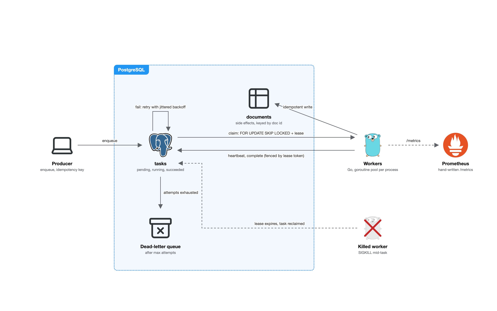
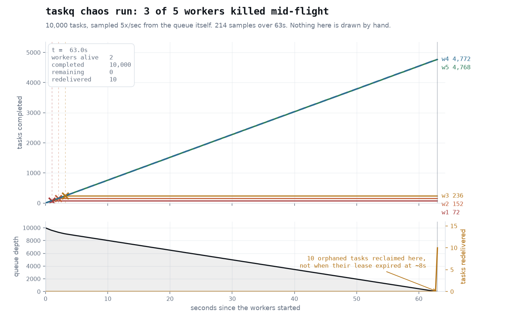

# taskq

A distributed job queue in Go, built on PostgreSQL with no message broker.

Workers claim tasks with `SELECT ... FOR UPDATE SKIP LOCKED`, hold them with a
lease, retry failures with backoff, and send tasks that keep failing to a
dead-letter queue. Delivery is at least once, so handlers are written to be
idempotent. The only dependency is the `pgx` Postgres driver.



## Results

Measured on an Apple M-series laptop (10 cores), PostgreSQL 18.4, Go 1.26,
everything on localhost.

**Crash test.** 10,000 tasks, 5 worker processes, 3 of them killed with
`SIGKILL` mid-run. Repeated 3 times:

| run | succeeded | lost | redelivered | duplicate writes absorbed |
|---|---|---|---|---|
| 1 | 10,000 | 0 | 12 | 4 |
| 2 | 10,000 | 0 | 12 | 8 |
| 3 | 10,000 | 0 | 12 | 12 |

No task was lost, and the idempotent write caught every duplicate delivery.



**Throughput.** Peaks at about 19,300 tasks/s with 16 workers. Each task needs
two writes to the same table (claim and complete), so Postgres is the limit,
not Go.

| workers | 1 | 4 | 8 | 16 | 32 |
|---|---|---|---|---|---|
| tasks/s (median) | 5,287 | 11,241 | 16,009 | 19,284 | 12,663 |

**Latency.** End to end, with 16 workers and 5 ms of work per task. p99 stays
at 15 ms up to 1,000 tasks/s and 28 ms at 2,000. Past about 2,200 tasks/s the
queue falls behind and latency climbs into seconds.

## How it works

- **Claiming.** One `UPDATE` wraps a `SELECT ... FOR UPDATE SKIP LOCKED`, so
  workers skip rows another worker has locked instead of waiting on them.
- **Leases.** A claimed task gets a visibility timeout that the worker extends
  with heartbeats. If the worker dies, the lease runs out and the same claim
  query hands the task to someone else. There is no separate cleanup process.
- **Fencing.** Each claim gets a new lease token, and completing a task requires
  that token. A slow worker whose lease expired cannot overwrite the new
  owner's result.
- **Retries.** Failures go back to pending with full-jitter exponential
  backoff. Attempts are counted when a task is claimed, so a task that crashes
  its worker still ends up in the dead-letter queue.
- **Idempotency.** Handlers write with `ON CONFLICT DO NOTHING` keyed on the
  business id, and producers can enqueue with an idempotency key.

## Things I learned

- **Recovered tasks wait at the back of the queue.** Ordering claims by
  `visible_at` puts an orphaned task behind the whole backlog, so in the crash
  test it was retried after 60 s instead of 5 s. Measured, not fixed.
- **My first benchmarks were measuring the machine.** Identical runs varied by
  2.1x. Running all configurations in a shuffled order and taking medians
  brought the spread down to 1.1 to 1.5x.
- **More aggressive autovacuum made it slower.** It removed 5x more dead rows
  but cut throughput by a quarter to a third, so I reverted it.
- **The first crash test did not test anything.** Every killed task died before
  writing, so the idempotent write never ran. A `linger_ms` option now widens
  that window and the test checks that duplicates actually happened.
- **Separate processes are 14 to 27% slower than goroutines** at the same
  concurrency. Lowering `GOMAXPROCS` explained about a quarter of the gap.

## Testing

15 integration tests against a real Postgres, run with `-race` in CI. A few of
them:

- `TestClaimIsExclusiveUnderConcurrency`: 32 goroutines drain 2,000 tasks and
  each task is delivered exactly once.
- `TestNaiveClaimDuplicates`: the same race against a plain select-then-update
  claim, which must produce duplicates. This shows the test above can catch a
  broken claim.
- `TestLostLeaseCannotRecordResult`: a worker with an expired lease cannot
  complete or fail the task.
- `TestDuplicateDeliveryProducesOneSideEffect`: one task delivered twice
  writes one document.

```
./scripts/migrate.sh taskq_test
go test -race ./...
```

## Running

```
createdb taskq
./scripts/migrate.sh taskq
go build -o bin/taskq ./cmd/taskq

bin/taskq produce -kind embed -n 1000     # enqueue tasks
bin/taskq work -n 8 -metrics :9090        # run workers, serve /metrics
bin/taskq stats -watch 1s                 # depth, lag, latency percentiles
bin/taskq dlq list                        # dead-letter queue
bin/taskq dlq requeue                     # retry dead tasks
./scripts/chaos.sh 10000 5 3              # the crash test
```

`DATABASE_URL` overrides the connection string. Metrics are served in
Prometheus text format, written by hand rather than with the client library.

## Known limitations

- Completed rows are never deleted, so throughput drops about 45% between a
  20,000 and a 200,000 task queue.
- Workers poll for new tasks. `LISTEN/NOTIFY` would lower idle latency but is
  not implemented.
- Throughput drops past 24 workers, and I have not found out why.
- Tasks are claimed one at a time. Batch claiming would cut round trips.
